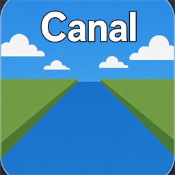
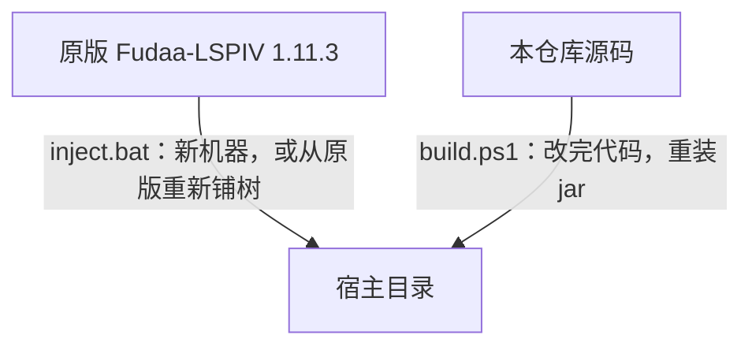
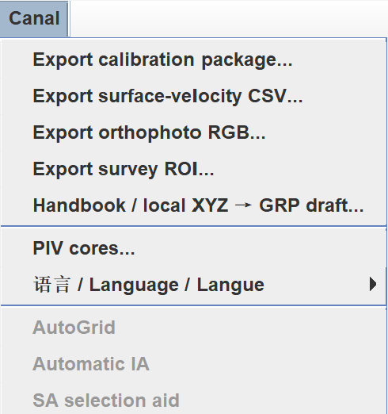
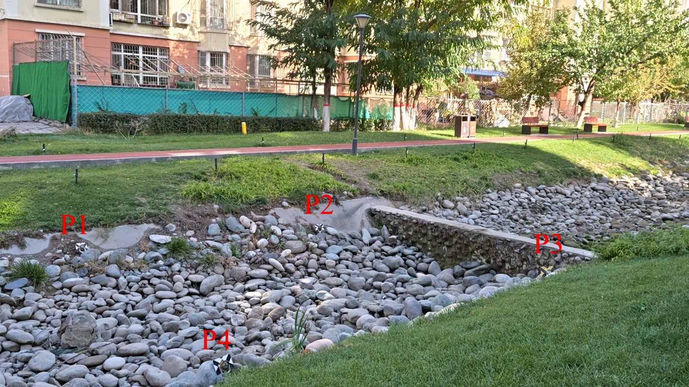
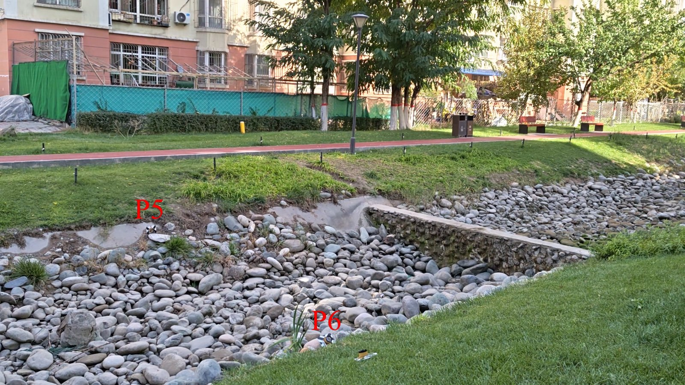
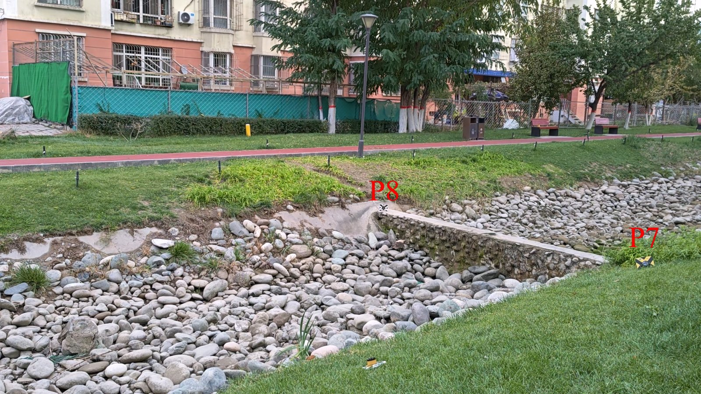
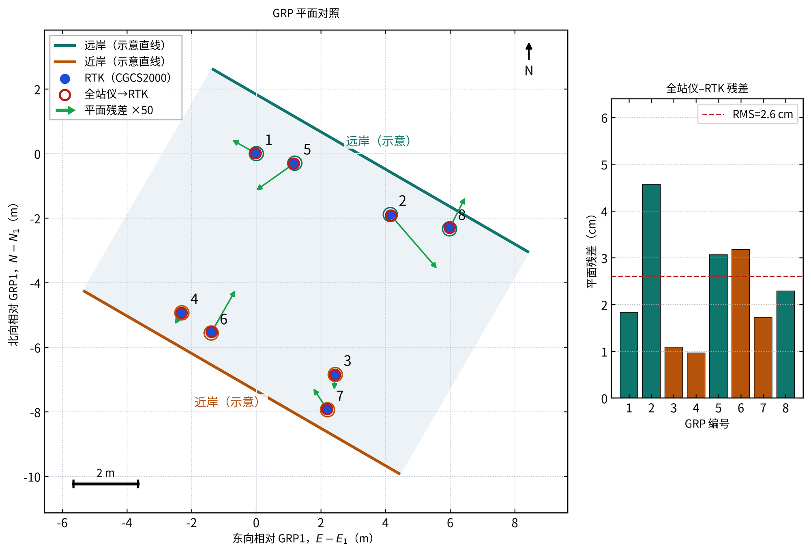

# Fudaa-LSPIV Canal



> **适用范围**：给自备的 Fudaa-LSPIV 1.11.3 挂上「Canal」菜单，导出定标包、表面流速 CSV、正射 RGB、测区 ROI，并把 RTK 手簿换成局部 XYZ 与 GRP 草稿。不改 Fudaa 的正射内核。
>
> **安全约定**：不修改原版安装目录。`appli.exe`、上游 jar、求解器 exe 不入库。现场照片和以 GRP 1 为参考的相对平面对照可以入文档，不写场地名称，也不含绝对坐标。真实测点、绝对 E/N/H 与真实手簿 CSV 不得写入 fixtures、文档或自检。样例坐标仍用虚构的「示例场地」。
>
> **配套文档**：[许可](LICENSE) · [声明](NOTICE) · [定标与手簿 CSV](docs/定标与手簿CSV.md) · [定标包与流速 CSV 摘录](docs/契约摘录.md) · [验收与开发循环](docs/验收与开发循环.md) · [注入包说明](inject/README.txt)
>
> **运行位置**：Canal 跑在宿主进程里。源码在本仓库；可运行的 Fudaa 树在本机另备。二者不要合成一仓。

---

## 一、产品标识

产品名称为 **Fudaa-LSPIV 1.11.3 Canal 1.1**。权威字符串在 `CanalBrand.VERSION`。窗体标题、关于对话框、`PatchPivLauncher.BRAND_VERSION`，以及 `build.ps1` / `inject/inject.ps1` 的 `jpackage.app-version` 与启动回显，都要和它一致。

Canal 1.1 在菜单里做这些事：手簿 CSV 转为局部 XYZ / GRP 草稿；导出测区 ROI 时可以补上局部原点（E0/N0），默认轴序为 X 东、Y 北。

| 项 | 约定 |
| --- | --- |
| 宿主 | Fudaa-LSPIV 1.11.3，使用者自行准备 |
| 插件版本 | Canal 1.1 |
| 显示名 | `Fudaa-LSPIV 1.11.3 Canal 1.1` |
| `jpackage.app-version` | `1.11.3-Canal-1.1`（不能含空格） |
| 界面语言 | 中文、English、Français |
| PIV 核数 | 1–99，只传给 `PIV.exe` 的第一个参数 |

名称里出现「Fudaa-LSPIV」只表示所配套的宿主。本仓库不是 INRAE、EDF 或 DeltaCAD 的官方产品。致谢与官方入口见第九节，声明见 [NOTICE](NOTICE)。

---

## 二、仓库里有什么

```text
src/canal/lspiv/          运行时代码，打成 canal-plugin.jar
src/canal/lspiv/ext/      预留扩展接口（不含 AutoGrid / IA / SA 业务）
build-src/canal/build/    构建期 ASM：给 PIV 启动补核数参数
tools/build_zh_resources.py
icons/                    成品图标（构建只拷贝，不缩放）
inject/                   注入器（打进发行 zip，不含 Fudaa 本体）
lib/                      OW2 ASM 9.7.1，仅构建补丁使用
ext-example/              扩展示例，不打进宿主插件 jar
docs/                     手簿、定标摘录、验收循环
build.ps1                 编译并安装到已有宿主
```

`build\` 与 `dist\` 是构建产物，已在 `.gitignore` 中。

改代码时先看这里：

| 目的 | 位置 |
| --- | --- |
| 窗口标题、关于、窗口图标 | `CanalBrand.java` |
| 开屏名称、版本、允许语言 | `build-src/.../PatchPivLauncher.java` 的 `BRAND_*` |
| Canal 菜单文案 | `CanalI18n.java`（下标 0 中文 / 1 英文 / 2 法文） |
| 语言切换 | `CanalLanguage.java` |
| 宿主中文词条 | `tools/build_zh_resources.py` |
| 定标、CSV、RGB、ROI、核数 | 同名 `*Exporter.java`、`PivCores.java`、`PivLaunch.java` |
| 投影反算 | `Cgcs2000.java`（仅高斯-克吕格） |
| 手簿到局部坐标 / GRP 草稿 | `HandbookImporter.java` |
| 注入包 | `build.ps1` 与 `inject/inject.ps1` 一起改 |

版本只改 `CanalBrand.VERSION` 这一处权威源，再按第一节的清单同步其余引用。

---

## 三、宿主目录怎么摆

源码与可运行宿主是两棵树。本仓库只保留源码；宿主是一份已经解开的 Fudaa-LSPIV 1.11.3，外加注入进去的 Canal。

典型摆法是三个同级目录。名字可以自定，脚本认的是下面两种关系，或环境变量 `FUDAA_CANAL_ROOT`。

```text
<工作目录>\
  Fudaa-Plugin-release\   本仓库（源码、注入器源文件）
  Fudaa-LSPIV-Canal\      开发宿主（完整 Fudaa + 已注入的 canal-plugin）
  Fudaa-LSPIV\            原版安装，只读对照
```

| 目录 | 角色 |
| --- | --- |
| 本仓库 | 源码所在。业务和文档的修改提交到这里。 |
| 开发宿主 | 带 `appli\` 与 `exes\` 的运行副本。`build.ps1` 把 jar 装进它的 `appli\app\canal\`。 |
| 原版安装 | 上游程序。注入器只从这里复制出新目录，不回写原版。 |

两种摆法都可以编译：

| 摆法 | 条件 |
| --- | --- |
| A（联调常用） | 本仓库放在宿主里面，目录名为 `canal-plugin`。脚本的上一级能找到 `appli\app\fudaa-lspiv.jar`。 |
| B | 本仓库与宿主同级，宿主目录名为 `Fudaa-LSPIV-Canal`。也可以把宿主根设到环境变量 `FUDAA_CANAL_ROOT`。 |

没有宿主树时，只能改源码和文档，不能完成本地编译与界面验收。不要把整份 Fudaa 推进 git。

---

## 四、注入与日常构建

注入和日常改代码不是同一步。



**注入**是从原版整树复制出一份 Canal 宿主，只在第一次，或给另一台机器做安装包时做。

**日常改特性**是改源码，再用 `build.ps1` 把 jar 装回已经存在的宿主，然后重启界面。耗时是一次编译拷贝，不是再复制整套 Fudaa。

### 日常构建

`build.ps1` 使用宿主自带的 Java 11，不需要另装系统 JDK。机器上需要 Python 3，用来生成中文词条。脚本会编译插件与补丁，安装到宿主 `appli\app\canal\`，写入 `appli.cfg`（若还没有备份则先写成 `appli.cfg.upstream`），写入启动 bat 与快捷方式，并在 `dist\Fudaa-LSPIV-Canal-inject\` 组装注入包与 zip。

【Windows PowerShell】

```powershell
Set-Location <宿主根>\canal-plugin
powershell -NoProfile -ExecutionPolicy Bypass -File .\build.ps1
```

摆法 B 时，在本仓库根目录执行同一条 `build.ps1`。脚本会向上查找同级的 `Fudaa-LSPIV-Canal`，或使用 `FUDAA_CANAL_ROOT`。

`appli.cfg` 的类路径顺序不可颠倒：`piv-core-fix.jar` 必须在 `fudaa-lspiv.jar` 之前。

```text
app.classpath=$APPDIR\canal\piv-core-fix.jar
app.classpath=$APPDIR\canal\canal-plugin.jar
app.classpath=$APPDIR\fudaa-lspiv.jar
app.mainclass=canal.lspiv.CanalBootstrap
java-options=-Djpackage.app-version=1.11.3-Canal-1.1
```

### 验收启动

构建之后，用宿主里的 `fudaa-lspiv-canal.bat` 启动，在「Canal」菜单上点功能。无界面时可以探测启动链。

【Windows 命令提示符】

```text
appli\appli.exe --canal-probe
```

日志 `appli\app\canal\canal.log` 出现 `PROBE_OK` 与 `Canal menu installed`，即启动链正常。

命令行复验与菜单使用同一套类，便于脚本化，不代替界面验收。

【Windows 命令提示符】

```text
appli\runtime\bin\java.exe -cp appli\app\canal\canal-plugin.jar canal.lspiv.CanalCli selfcheck
```

子命令还有 `export-calib`、`export-csv`、`export-roi`、`export-rgb`、`grp-draft`。参数见 `CanalCli`。手簿列序、过滤规则与示例场地方程见 [docs/定标与手簿CSV.md](docs/定标与手簿CSV.md)。

### 整机注入

在注入包目录执行。目标已存在时加 `-Force` 会先删除再复制。原版目录不会被修改。

【Windows 命令提示符】

```text
inject.bat D:\Fudaa-LSPIV
inject.bat D:\Fudaa-LSPIV D:\Fudaa-LSPIV-Canal
```

完成后用目标目录里的 `fudaa-lspiv-canal.bat` 或快捷方式启动。

---

## 五、Canal 菜单

`CanalBootstrap` 挂上菜单后，进入原来的 `org.fudaa.fudaa.piv.Piv.main`。菜单名是「Canal」（内部名 `mnCanal`）。

下图是界面语言为 English 时的菜单。末三项呈灰显：钩子已经挂上，没有业务实现。



| 菜单（中文） | 截图中的英文 | 做什么 |
| --- | --- | --- |
| 导出定标包... | Export calibration package... | 七件套平铺，另写 tar.gz。包内没有 `coeff.dat`。 |
| 导出表面流速 CSV... | Export surface-velocity CSV... | 九列，只读 `vel_real`。`corr_raw` 小于等于 -98 时 `w_corr` 为 0。 |
| 导出正射 RGB... | Export orthophoto RGB... | 调用 `transf_a.exe`，写入 `img_ortho_rgb`，不替换 PIV 用的 PGM。 |
| 导出测区 ROI... | Export survey ROI... | GRP / 网格投影反算。四角顺序 SW、SE、NE、NW。默认 X 东 Y 北。局部坐标填写 E0/N0 后自动加回。 |
| 手簿 / 局部XYZ → GRP 草稿... | Handbook / local XYZ → GRP draft... | RTK 手簿 CSV 加原点，得到局部 `id,X,Y,Z` 与 `GRP V2.0` 草稿（`i j` 为 `0 0`）。 |
| PIV 核数... | PIV cores... | 1–99，写入 `appli\app\canal\piv-ncore.properties`。只给 `PIV.exe` 的第一个参数补核数。 |
| 语言 / Language / Langue | 语言 / Language / Langue | 写入宿主首选项 `locale.language`，确认后重启。允许 `zh`、`en`、`fr`。 |
| 自动网格 (AutoGrid) | AutoGrid | 灰显钩子，无业务实现。 |
| 自动 IA | Automatic IA | 灰显钩子，无业务实现。 |
| SA 选区辅助 | SA selection aid | 灰显钩子，无业务实现。 |

使用导出前，先在 Fudaa 里打开工程并写出 `outputs.dir`。表面流速 CSV 还需要 `vel_real`。彩色正射还需要 `outputs.dir\coeff.dat`（只给正射用，不进定标包）。

定标包的七个文件是 `GRP.dat`、`img_ref.dat`、`PIV_param.dat`、`grid.dat`、`h.dat`、`site.json`、`SHA256SUMS`。字段摘录见 [docs/契约摘录.md](docs/契约摘录.md)。

---

## 六、语言

菜单「语言 / Language / Langue」写入宿主首选项 `locale.language`。确认之后需要重启，宿主菜单才会全部切换。允许语言补丁为 `zh,en,fr`。

中文只翻译完整词条，不做子串替换。没有译条的宿主字符串回退英文。Canal 自己的句子在 `CanalI18n`，不走宿主资源包。

---

## 七、手簿与示例场地

手簿列序是「点名、编码、N、E、H」。点名空白、以「基站」开头（如 `基站_1`）、以 `test` 开头的行视为噪音丢弃。GRP 点名多为数字 `1..n`。

局部坐标约定：

```text
X = E − E0（东）    Y = N − N0（北）    Z = H
```

仓库里的样例是虚构的「示例场地」，不是实测点。

| 项 | 示例场地 |
| --- | --- |
| 原点 E0 | 500000 m |
| 原点 N0 | 4000000 m |
| 高程 | 约 10 m（水位与 Z 同一基准，示例约 10.2，不要填 0） |
| 手簿样例 | `docs/fixtures/rtk_handbook_sample.csv` |
| 局部表 | `docs/fixtures/grp_fudaa_xyz.csv` |
| GRP 草稿 | `docs/fixtures/GRP_draft.dat`（演示宽高 1920×1080，`i j` 为 `0 0`） |
| 加回原点后的 NEH | `docs/fixtures/roi_neh_corrected.csv` |

8 个 GRP 点的平面相对位置是一组固定几何，用来检验导入与往返闭合。绝对坐标和高程已经换成示例场地，不能据此对应真实测区。

现场照片和以 GRP 1 为参考的相对平面对照可以入文档，不写场地名称，也不含绝对坐标。真实测点、绝对 E/N/H 与真实手簿 CSV 不得写入 fixtures、文档或自检。

八个 GRP 沿河槽与两岸布设。三张照片取自同一机位，合起来标出 GRP 1–8。平面对照把全站仪位置变换到 RTK（CGCS2000）同一框架，只保留相对 GRP 1 的平面位置。全站仪仅作可选校核。



同一机位，合起来为 GRP 1–8。本张标出 GRP 1–4。



同一机位，合起来为 GRP 1–8。本张标出 GRP 5–6。



同一机位，合起来为 GRP 1–8。本张标出 GRP 7–8。



平面位置相对 GRP 1，不含绝对坐标。RTK（CGCS2000）与变换到同一框架的全站仪位置对照；平面残差 ×50；八点平面残差均方根为 2.6 cm。近岸、远岸直线为示意，不是实测岸线。

ROI 只支持 CGCS2000 高斯-克吕格。局部坐标必须显式加回 E0/N0，不要把绝对 NEH 当成局部坐标灌进正射。列序、过滤、卫兵与可复制的命令见 [docs/定标与手簿CSV.md](docs/定标与手簿CSV.md)。

---

## 八、扩展钩子

实现 `canal.lspiv.ext.CanalAssist`，在 `META-INF/services/canal.lspiv.ext.CanalAssist` 登记，把 jar 放到 `appli/app/canal/ext/`，然后重启。`isAvailable()` 为 true 时，对应菜单才可点。

稳定 id 是 `autogrid`、`auto-ia`、`sa-assist`。`ext-example/` 只有骨架，菜单上的「自动网格」「自动 IA」「SA 选区辅助」保持灰显。

---

## 九、致谢

感谢 Fudaa-LSPIV 的作者与维护者。该软件自 2010 年起由 EDF 与 INRAE 合作开发并发行，实现方为 DeltaCAD。

Canal 是 Fudaa-LSPIV 1.11.3 的独立衍生插件，不是 INRAE、EDF 或 DeltaCAD 的官方产品，也未获上述机构背书。「Fudaa」与「LSPIV」的名称归各自权利人所有。

本仓库不包含 Fudaa-LSPIV 程序本身。请从官方项目取得安装。除非能够同时履行 GPL-2.0 对相应源代码的义务，不要再分发原厂程序树（`appli.exe`、上游 jar 等）。

| 材料 | 位置 |
| --- | --- |
| 官方项目页 | <https://riverhydraulics.riverly.inrae.fr/eng/tools/measurement-software/fudaa-lspiv> |
| 用户手册 | <https://gitlab.com/fudaa/fudaa-lspiv/-/wikis/home> |
| 界面源码（GNU GPL v2） | <https://gitlab.com/fudaa/fudaa-lspiv> |

上游项目页请求的软件引用：

Le Coz, J., Jodeau, M., Hauet, A., Marchand, B., Le Boursicaud, R. (2014). Image-based velocity and discharge measurements in field and laboratory river engineering studies using the free FUDAA-LSPIV software. River Flow 2014, Lausanne, Switzerland.

---

## 十、许可与归属

Canal 原创插件源码、注入脚本、构建脚本和文档，以 GNU GPL 第 2 版或（按你的选择）任何更新的版本授权。授予在 [NOTICE](NOTICE)，许可证全文在 [LICENSE](LICENSE)。

请同时阅读 [NOTICE](NOTICE)。其中说明：

1. 这是独立的 Canal 衍生，不是 INRAE、EDF 或 DeltaCAD 的官方产品。致谢、官方入口与文献引用见第九节。
2. Fudaa-LSPIV 为 GPL-2.0，且没有放进本仓库。请从官方项目取得 1.11.3。再分发原厂程序树时，须能履行 GPL-2.0 的相应源代码义务。
3. `lib/asm-9.7.1.jar` 与 `lib/asm-commons-9.7.1.jar` 是 OW2 ASM 9.7.1，BSD-3-Clause。全文在 [lib/ASM-LICENSE](lib/ASM-LICENSE)。
4. `icons/icone-lspiv.png` 是上游 64×64 开屏图，保留它是为了宿主开屏。`icons/Canal.png`、`icons/canal-icon.png`、`icons/canal.ico` 是 Canal 原创标识。

---

## 十一、不要破坏的约定

- 不修改原版 Fudaa-LSPIV 目录。
- 不把原厂可执行文件或上游 jar 提交进本仓库。
- `piv-core-fix.jar` 位于 `fudaa-lspiv.jar` 之前。
- 核数只传给 `PIV.exe`，范围 1–99。
- 定标包七个文件，没有 `coeff.dat`。
- ROI 仅支持 CGCS2000 高斯-克吕格。局部坐标必须显式加回 E0/N0。
- 开屏图标保持 64×64（`icone-lspiv.png`）。
- 样例坐标保持虚构的「示例场地」。现场照片和以 GRP 1 为参考的相对平面对照可以入文档，不写场地名称，也不含绝对坐标。真实测点、绝对 E/N/H 与真实手簿 CSV 不得写入 fixtures、文档或自检。
