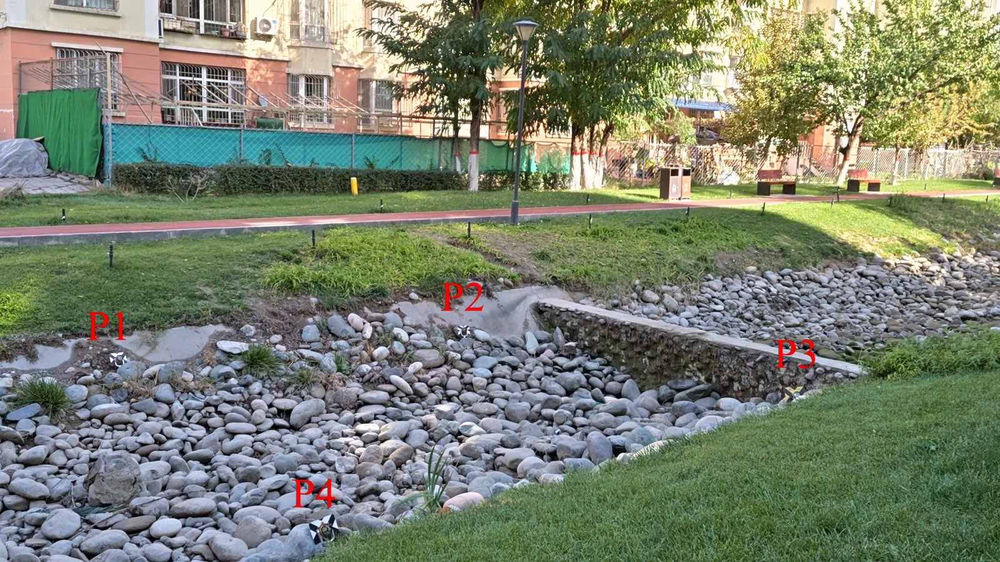
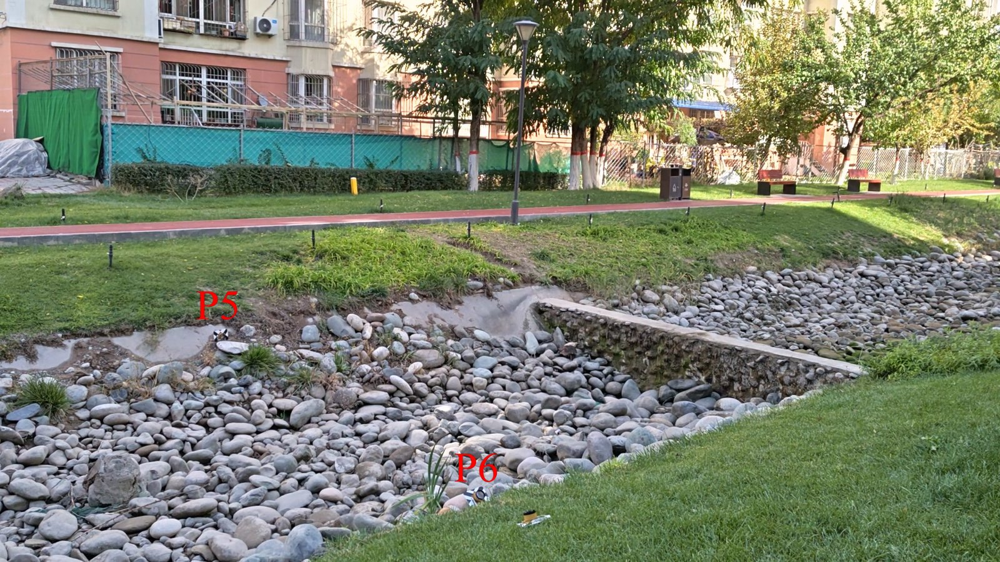
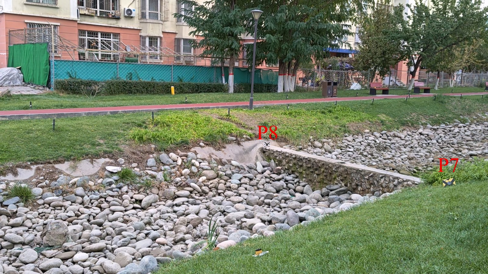
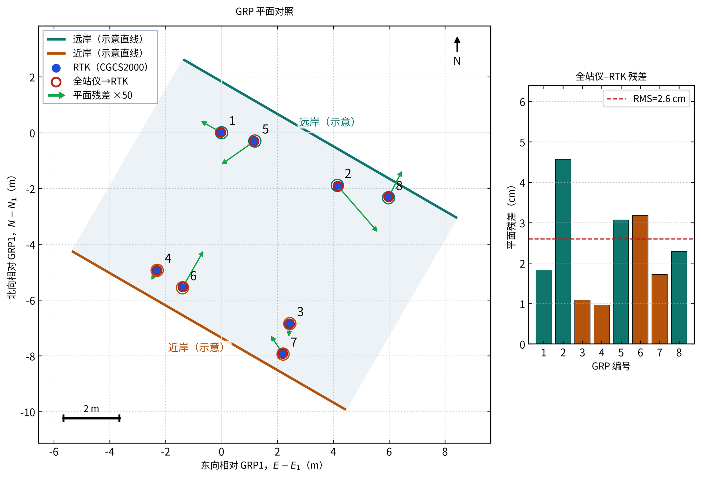

# 定标与手簿 CSV（RTK → 局部 XYZ / GRP 草稿）

坐标主输入是 RTK 手簿导出的标准 CSV（电子），人在正射图上点像点；本插件只做「手簿 → 局部表 / GRP 草稿」与「ROI 反算加回原点」两件事，不改 Fudaa 正射内核。全站仪仅作可选校核。

文中与 [fixtures](fixtures/rtk_handbook_sample.csv) 里的数字都是虚构的「示例场地」：原点 `E0 = 500000`、`N0 = 4000000`，高程在 10 m 附近。8 个 GRP 点是一组固定的平面几何，只用于列序、过滤与往返闭合，不对应任何实测场地。现场照片和以 GRP 1 为参考的相对平面对照见第 8 节：不写场地名称，不含绝对坐标。真实测点、绝对 E/N/H 与真实手簿 CSV 不得写入 fixtures、文档或自检。

## 1. RTK 手簿 CSV

- 列序：`点名,编码,N,E,H`。表头可有可无；分隔符逗号 / 分号 / Tab 均可；编码 UTF-8 或手簿默认（GBK），工具自动识别。
- `N`/`E` 为 CGCS2000 高斯-克吕格投影平面坐标（米）：三度带、假东 500000。示例场地的东坐标就在假东附近、不含带号；`H` 为高程（米，1985 高程基准）。
- 过滤规则：点名空白、`基站*`（如 `基站_1`）、`test*` 的行视为噪音丢弃；GRP 点名多为数字 `1..n`。
- 样例：[fixtures/rtk_handbook_sample.csv](fixtures/rtk_handbook_sample.csv)（含 2 行噪音与 8 个 GRP 点）。

## 2. 局部原点约定（为何需要）

Fudaa 正射的工程坐标是**场地局部**米：

```text
X = E − E0（东）    Y = N − N0（北）    Z = H
```

示例场地取 `E0 = 500000`、`N0 = 4000000`。若把绝对高斯米（E、N 为十万米以上）当局部坐标灌进正射，量级相差约四个数量级，直接表现为黑图 / 超大像素；局部表同时让图上点像点与流速 CSV 的 `x,y` 都落在几十米尺度上。

正射口诀（都在 Fudaa 宿主菜单完成，插件不改核）：

1. 局部 XYZ + 点像点 → 验证参考点（Gap 宜 cm 级）；
2. 水位与 Z 同基准（勿填 0，示例场地约 10.2）；
3. 分辨率约 `0.01`–`0.02` m/pix，范围包住 GRP；
4. Apply 预览通过再 Transfer。

## 3. GRP.dat V2.0 草稿格式

```text
GRP V2.0 <W> <H>
<点数>
X  Y  Z  i  j
<X1> <Y1> <Z1> 0 0
...
```

- `W H` 为相机图像宽高（像素）；未知时先 `0 0`，导定标包时会以真实值替换。
- 草稿 `i j = 0 0`：像点列留空，导入 Fudaa「导入参考点」后在图上逐点点像点。
- XYZ 一律从手簿 CSV 灌入，禁止逐格手敲。

## 4. 工具：手簿 → 局部表 + GRP 草稿

菜单：**Canal → 手簿 / 局部XYZ → GRP 草稿...**（填法同下）。

CLI（挂 `CanalCli`，与菜单同一套 `HandbookImporter`）：

```text
appli\runtime\bin\java.exe -cp appli\app\canal\canal-plugin.jar canal.lspiv.CanalCli grp-draft --csv <手簿.csv> --origin-e <E0> --origin-n <N0> [--width W --height H] --out-local <局部.csv> [--out-grp <GRP.dat>]
```

示例场地可在宿主根目录执行。样例取本仓库 fixture。下面按「本仓库与宿主目录同级、仓库名为 Fudaa-Plugin-release」书写；若仓库已放在宿主内的 `canal-plugin`，把 `--csv` 改成该相对路径。

【Windows 命令提示符】

```text
appli\runtime\bin\java.exe -cp appli\app\canal\canal-plugin.jar canal.lspiv.CanalCli grp-draft --csv ..\Fudaa-Plugin-release\docs\fixtures\rtk_handbook_sample.csv --origin-e 500000 --origin-n 4000000 --width 1920 --height 1080 --out-local grp_local_xyz.csv --out-grp GRP_draft.dat
```

- 输出 1：局部表 `id,X,Y,Z`（id=点名、X=E−E0、Y=N−N0、Z=H），样例输出即 [fixtures/grp_fudaa_xyz.csv](fixtures/grp_fudaa_xyz.csv)。
- 输出 2：GRP 草稿，样例输出即 [fixtures/GRP_draft.dat](fixtures/GRP_draft.dat)。
- 输入已是局部 `id,X,Y,Z`（3 或 4 列）时**不要**给原点，工具直接生成 GRP 草稿。
- 卫兵：减完原点 |X|/|Y| 仍 >10 km、N/E 疑似颠倒、或 N/E 量级像经纬度（度）时打印警告（菜单里弹窗提示），请先核对 E0/N0 与列序。

## 5. ROI 导出：局部坐标加回原点

- GUI「导出测区 ROI」对话框提供 **原点 E0 / N0**（留空 = X/Y 已是绝对投影坐标）。填写后与 CLI `export-roi --origin-e/--origin-n` 走同一个 `RoiExporter` 路径：反算前 `E = X + E0`、`N = Y + N0`。
- 轴序默认 **X东 Y北**（与正射 `X=E−E0` 一致）；测量高斯习惯（x=N、y=E）可显式切换，不会静默弄反。
- 量级卫兵（对话框内确认）：X/Y 很大提示疑似绝对坐标；很小且无原点提示经纬度将错；已很大却又填原点提示疑似重复加回。
- 验收口径：轴序选对的前提下，`grp_points.csv` / `roi_points.csv` 的 `easting_m/northing_m`（及 lon/lat）等于 `x_m+E0 / y_m+N0` 的反算结果；`camera_roi.json` 中 `crs.local_origin=true`、`origin_easting_m/origin_northing_m` 为所填值。
- 「局部加回后」的 NEH 示例见 [fixtures/roi_neh_corrected.csv](fixtures/roi_neh_corrected.csv)：与手簿原值一致，即往返闭合。

## 6. fixtures 一览

| 文件 | 内容 |
| --- | --- |
| `rtk_handbook_sample.csv` | 手簿标准样例（`基站_1`、`test` 噪音行 + 8 个 GRP 点） |
| `grp_fudaa_xyz.csv` | 上表减示例场地原点后的局部 `id,X,Y,Z`（grp-draft 局部输出样例） |
| `GRP_draft.dat` | 由样例生成的 GRP V2.0 草稿（演示取 W H=1920×1080，`i j=0 0`） |
| `roi_neh_corrected.csv` | 局部加回 E0/N0 后的 NEH（与手簿一致，验证往返闭合） |

fixtures 可用第 4 节命令重新生成；`roi_neh_corrected.csv` 即局部表各列加回 E0/N0。

## 7. 明确不做

- 不改 Fudaa 正射内核水位 / 分辨率 UI；
- 不自动点像点、不重做 AutoGrid；
- 不把绝对 NEH 灌进正射当默认。

## 8. 现场布点与全站仪校核

八个 GRP 沿河槽与两岸布设。三张照片取自同一机位，合起来标出 GRP 1–8。平面对照只保留相对 GRP 1 的位置。全站仪仅作可选校核，不代替手簿。



同一机位，合起来为 GRP 1–8。本张标出 GRP 1–4。



同一机位，合起来为 GRP 1–8。本张标出 GRP 5–6。



同一机位，合起来为 GRP 1–8。本张标出 GRP 7–8。



平面位置相对 GRP 1，不含绝对坐标。RTK（CGCS2000）与变换到同一框架的全站仪位置对照；平面残差 ×50；八点平面残差均方根为 2.6 cm。近岸、远岸直线为示意，不是实测岸线。
